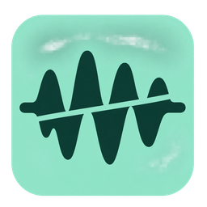

<p align="center">
  
</p>

<h1 align="center">MediaToolsPro</h1>
<p align="center">Recorta, divide y normaliza tus archivos. Con precisión y en tu equipo.</p>
<p align="center">
  <a href="https://github.com/NaturalDevCR/MediaToolsPro/releases/latest">Descargar</a> ·
  <a href="#primeros-pasos">Primeros pasos</a> ·
  <a href="#desarrollo">Desarrollo</a> ·
  <a href="CHANGELOG.md">Historial de cambios</a> ·
  <a href="https://github.com/NaturalDevCR/MediaToolsPro/issues">Reportar un problema</a>
</p>

[](https://github.com/NaturalDevCR/MediaToolsPro/actions/workflows/release.yml)
[](https://github.com/NaturalDevCR/MediaToolsPro/releases/latest)

**MediaToolsPro es un estudio de escritorio para archivos locales de audio y video.** Reúne tres tareas: conservar un fragmento con **Trim**, crear segmentos con **Split** y ajustar la sonoridad con **Normalize**. Está construido con Tauri 2, Vue 3, TypeScript y FFmpeg.

La versión **0.3.0** reorganiza la aplicación alrededor de estas herramientas y retira las funciones de descarga de canciones. El procesamiento se realiza localmente; no hace falta subir tus archivos a un servicio.

## Descargar e instalar

Los instaladores están en [GitHub Releases](https://github.com/NaturalDevCR/MediaToolsPro/releases/latest). Elige el paquete de tu sistema y arquitectura:

| Plataforma | Arquitectura                        | Paquetes                     | Instalación                                              |
| ---------- | ----------------------------------- | ---------------------------- | -------------------------------------------------------- |
| macOS      | Apple Silicon: M1, M2 y posteriores | `.dmg`                       | Abre la imagen y copia MediaToolsPro a Aplicaciones.     |
| macOS      | Intel                               | `.dmg`                       | Usa la variante x64.                                     |
| Windows    | x64                                 | `.exe` o `.msi`              | Ejecuta uno de los dos instaladores.                     |
| Linux      | x64                                 | `.deb`, `.rpm` o `.AppImage` | Usa el paquete de tu distribución o ejecuta la AppImage. |

Los paquetes no incluyen firma de distribución de Apple/Microsoft ni notarización. macOS o Windows pueden mostrar un aviso de seguridad. Descarga únicamente desde las releases de este repositorio y consulta las opciones de apertura que ofrezca tu sistema.

Cada release incluye **`SHA256SUMS.txt`** para comprobar la integridad de los instaladores. Por ejemplo, compara el resultado de `shasum -a 256 nombre-del-archivo` en macOS, `sha256sum nombre-del-archivo` en Linux o `Get-FileHash nombre-del-archivo -Algorithm SHA256` en PowerShell con el valor publicado.

### Motor FFmpeg

FFmpeg es necesario y **se instala por separado**. MediaToolsPro reconoce una instalación del sistema o la instalación administrada desde **Ajustes**.

- **macOS:** se recomienda instalar FFmpeg nativo mediante Homebrew con `brew install ffmpeg`. Se reconocen `/opt/homebrew/bin/ffmpeg` y `/usr/local/bin/ffmpeg`. El instalador integrado usa la distribución de Evermeet; en Apple Silicon, Homebrew evita depender de un ejecutable Intel.
- **Windows:** instala el motor desde Ajustes o añade una instalación de FFmpeg a `PATH`. La aplicación utiliza WebView2 como motor de interfaz.
- **Linux:** instala FFmpeg con el gestor de paquetes de tu distribución. Por ejemplo, en Debian/Ubuntu: `sudo apt install ffmpeg`. Los paquetes necesitan un entorno de escritorio compatible con WebKitGTK 4.1; AppImage no sustituye todas las dependencias del sistema.

La instalación del motor necesita internet. Una vez disponible FFmpeg, puedes procesar tus archivos sin conexión.

## Herramientas

| Herramienta   | Controles principales                                                                             | Resultado                                             |
| ------------- | ------------------------------------------------------------------------------------------------- | ----------------------------------------------------- |
| **Trim**      | Selección sobre la onda, inicio/final con milisegundos, preescucha en bucle y fades.              | Un archivo con el fragmento seleccionado.             |
| **Split**     | Capítulos, silencios, duración fija o cortes manuales, con fades y normalización opcionales.       | Un archivo independiente por segmento.                |
| **Normalize** | Objetivo LUFS, techo de true peak y presets Podcast, Streaming y Broadcast.                       | Archivos con sonoridad ajustada mediante dos pasadas. |

### Forma de onda e inspección de silencios

- **Zoom de 1× a 64×**, desplazamiento horizontal y regla temporal adaptativa. El editor dibuja los datos medidos del tramo visible.
- Lectura de **pico y RMS en dBFS**, calculados en ventanas de **20 ms**. Mueve el puntero para inspeccionar; haz clic para situar el cursor.
- En Split por silencios se muestra el umbral elegido, las pausas que cumplen la duración mínima y la duración aproximada de la pausa bajo el puntero.
- Puedes aplicar un umbral basado en el pico medido con 3 dB de margen o una pausa mínima equivalente al 80 % de la pausa observada. Son puntos de partida que puedes ajustar.
- La escala vertical de la onda va de −80 a 0 dBFS. Los niveles y las pausas de la vista son orientativos; el análisis de silencios de FFmpeg confirma los cortes.

### Exportación y formatos

Audio: **WAV, FLAC, MP3, M4A, OGG y Opus**. Para Trim/Split de video también se ofrecen **MP4, MKV y WebM**. Normalize exporta audio.

Puedes guardar junto al archivo de origen o en una carpeta personalizada. La cola admite **dos tareas simultáneas**, cancelación, reintentos, historial y acceso a la carpeta de resultados. Si cierras la app durante una tarea, aparecerá como interrumpida en la siguiente sesión y podrás reintentarla.

Los originales se conservan. Las exportaciones usan nombres disponibles y no sobrescriben resultados anteriores. La edición recodifica el resultado: WAV/FLAC evitan una nueva codificación con pérdida, pero no recuperan información que ya se hubiera perdido en el original.

## Primeros pasos

### Recortar con Trim

1. Importa o arrastra uno o varios archivos y selecciona el que vas a editar.
2. Ajusta los extremos de la selección sobre la onda o escribe los tiempos. Se aceptan segundos y `mm:ss.mmm` / `hh:mm:ss.mmm`.
3. Escucha la selección, activa el bucle si lo necesitas y configura los fades.
4. Elige formato y destino; pulsa **Exportar recorte**.

### Dividir con Split

Selecciona un método de división.

- **Por capítulos:** pulsa **Leer capítulos**. El archivo debe contener capítulos incrustados. Si faltan, la aplicación lo indica; puedes elegir silencios o cortes manuales.
- **Por silencios:** mide una pausa en la onda, ajusta **umbral**, **pausa mínima** y **segmento mínimo**, y pulsa **Detectar silencios**. Los cortes se colocan en el centro de las pausas válidas.
- **Por duración:** introduce un intervalo en segundos o en `mm:ss.mmm` y pulsa **Generar segmentos**. Los cortes se cuentan desde el inicio de la selección y se conserva el tramo final más corto. Activa **Buscar una pausa cerca de cada corte** y configura la ventana, la pausa mínima y el umbral. Si falta una pausa en la ventana, se usa el tiempo original del corte.
- **Manual:** haz doble clic en la onda, añade un corte en el cursor o introduce un tiempo exacto. Puedes retirar marcas de la lista.

Revisa y escucha los segmentos. **Ajustar manualmente** copia los cortes generados para que puedas editarlos. En cualquiera de los cuatro métodos, ajusta los fades de entrada y salida en segundos. Usa **0** para desactivar un fade. Cada fade dura como máximo la mitad de su segmento.

Puedes aplicar **Normalización de sonoridad** antes de dividir para medir y ajustar toda la selección en conjunto, o después de dividir para medir y ajustar cada segmento con sus fades. Elige un preset o ajusta los objetivos de LUFS y true peak. Pulsa **Exportar segmentos** para aplicar toda la configuración.

Usa **A/B** junto al segmento para alternar entre el audio original y el procesado en la misma posición. La preescucha usa audio WAV con los fades y la normalización que hayas configurado.

En **Exportación** puedes usar un patrón como `Pista-{numero} - {archivo}`. La aplicación añade la extensión y mantiene nombres disponibles si hay una coincidencia. Guarda el flujo con **Guardar preset** y recupéralo desde **Preset de Split** cuando abras otro archivo. Las marcas manuales se definen para cada archivo.

### Ajustar sonoridad con Normalize

1. Añade los archivos que vas a normalizar. Cada uno se mide y procesa por separado.
2. Elige un preset o configura el objetivo: Podcast **−16 LUFS**, Streaming **−14 LUFS** o Broadcast **−23 LUFS**. Estos son objetivos de sonoridad, no certificaciones de entrega.
3. Ajusta el techo de true peak, el formato y la carpeta de salida.
4. Pulsa **Normalizar archivos** y revisa el avance en Exportaciones.

La primera pasada mide la sonoridad; la segunda aplica el ajuste. La salida se genera a **48 kHz**, con un rango objetivo de **11 LU**. FFmpeg puede aplicar normalización dinámica cuando el objetivo requiere limitar picos o reducir el rango. El techo de true peak se aplica antes de la codificación: los formatos con pérdida pueden introducir pequeñas variaciones.

### Atajos del editor

| Tecla               | Acción                              |
| ------------------- | ----------------------------------- |
| `Espacio`           | Reproducir o pausar.                |
| `I` / `O`           | Usar el cursor como inicio / final. |
| `M`                 | Añadir un corte en Split manual.    |
| `←` / `→`           | Mover el cursor 1 segundo.          |
| `Shift` + `←` / `→` | Mover el cursor 0,1 segundos.       |

Los atajos no se activan mientras escribes en un campo.

## Datos y archivos temporales

El historial de tareas y el tema se guardan localmente. La aplicación almacena audio de preescucha y niveles medidos en su carpeta de caché; los instaladores administrados de FFmpeg quedan en los datos de la app. No se envían tus archivos a un servidor de procesamiento.

## Desarrollo

Requisitos:

- **Node.js 24 LTS** recomendado; las pruebas también admiten Node.js 22.18+.
- **pnpm 11.1.1**, según `packageManager` en `package.json`.
- **Rust estable**, Cargo y las [dependencias nativas de Tauri](https://v2.tauri.app/start/prerequisites/) para el sistema de destino.
- **FFmpeg en `PATH`** para las pruebas de integración de audio.

```sh
git clone https://github.com/NaturalDevCR/MediaToolsPro.git
cd MediaToolsPro
pnpm install --frozen-lockfile
pnpm tauri dev
```

`pnpm dev` abre únicamente el frontend para revisar la interfaz en el navegador. La importación de archivos y el procesamiento necesitan la aplicación de escritorio.

### Comprobaciones

```sh
pnpm build
pnpm test
cargo test --locked --manifest-path src-tauri/Cargo.toml
pnpm test:media
pnpm release:check app-v0.3.0
```

`pnpm test:media` incluye FFmpeg real para comprobar tiempos de recorte, capítulos, silencios, niveles, normalización y cancelación. También hay pruebas de exportaciones simultáneas para evitar sobrescrituras. Las pruebas que requieren FFmpeg están marcadas como ignoradas en la ejecución predeterminada de Cargo y se incluyen con ese comando.

### Compilar instaladores

```sh
pnpm tauri build
# Aplicación de depuración para macOS:
pnpm tauri build --debug --bundles app
```

Los resultados se generan dentro de `src-tauri/target/`. La compilación necesita las herramientas nativas del sistema de destino. GitHub Actions usa máquinas separadas para producir los paquetes de cada plataforma.

### Publicar una versión

1. Actualiza la versión en `package.json`, `src-tauri/Cargo.toml`, `src-tauri/Cargo.lock` y `src-tauri/tauri.conf.json`.
2. Añade las notas en `.github/release-notes/<versión>.md` y actualiza `CHANGELOG.md`.
3. Ejecuta las comprobaciones y publica un tag `app-v<versión>` sobre el commit correspondiente.
4. El workflow **Release** valida el código, prepara un borrador y compila los cuatro destinos.
5. Solo cuando todos los builds terminan correctamente, verifica los siete tipos de instaladores esperados, genera `SHA256SUMS.txt` y publica la release.

Si falla una plataforma, la release permanece en borrador. Se puede reintentar el workflow para el mismo tag antes de publicarlo. Los instaladores de una versión ya pública no se reemplazan automáticamente.

## Reportar un problema

Abre un [issue](https://github.com/NaturalDevCR/MediaToolsPro/issues) e indica la versión de MediaToolsPro, sistema y arquitectura, versión de FFmpeg, herramienta utilizada y pasos para reproducirlo. Si hay un error, incluye el mensaje de **Actividad** y un archivo de ejemplo que puedas compartir.

Desarrollado por [NaturalDevCR](https://github.com/NaturalDevCR).
